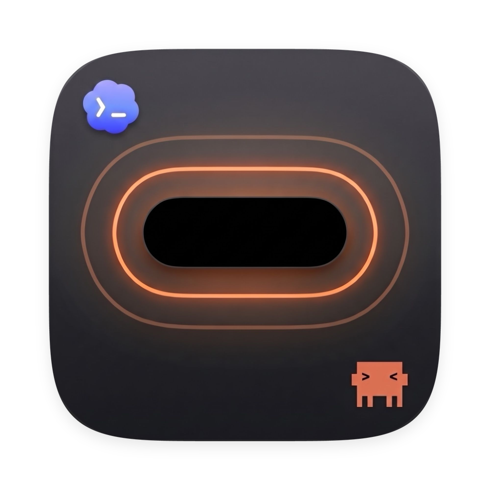
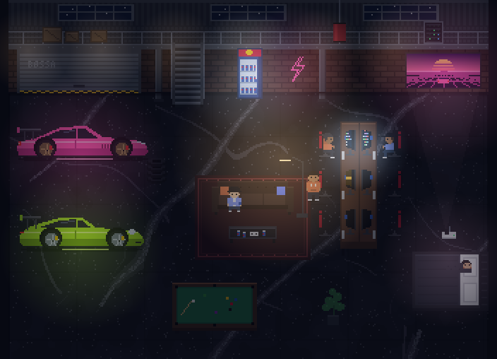
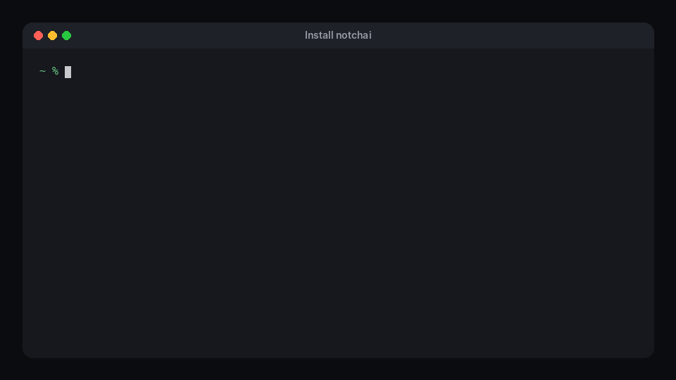

<p align="center">
  
</p>

<h1 align="center">lumo</h1>

<p align="center">
  Your MacBook notch as a control center for <b>Claude Code</b> and <b>Codex</b>.<br>
  See who is working, who is waiting for you and who is done – and answer right from the notch.
</p>

<p align="center">
  <a href="https://github.com/Bossaln/lumo/releases/latest"></a>
  
  
  <a href="LICENSE"></a>
</p>

```sh
brew install --cask bossaln/tap/lumo
```

lumo speaks **English** and **German** – pick your language in the first step of the setup or later in
**Settings › General**.

> **Formerly notchai.** Until version 0.7.0 this app was called *notchai*. If you still have it installed, see
> [Switching from notchai](#switching-from-notchai).

## What it does

**Signals in the notch.** When an agent asks for permission, asks a question, finishes or fails, the notch opens
and glows in that agent's color. Allow, deny, pick an answer or type a reply without leaving what you are doing.
Choose between three styles: a flat island next to the camera, a wide banner, or a taller panel.

**Every session at a glance.** Hover over the notch to see your active Claude Code and Codex sessions: title,
project, last step, how full the context is, and what you got done today. Click a session for its details – where it
runs, folder, model, context in tokens and, for Codex, how much of your 5-hour and weekly limit is used – and bring
its window to the front, reply to it or remove it from the notch. Sessions disappear by themselves when you close
them. Works with the terminal, VS Code, Cursor, cmux and Claude Code sessions in the Claude and Codex apps.

**External displays, too.** Every external display gets a notch of its own, top center and as tall as the menu bar.
Since there is no camera, its middle is free for something useful: your agents at a glance (a dot per session,
orange when one is waiting), what the last one is doing, or the song that is playing – one of them or all in turn.
The time sits on the left, music or the number of sessions on the right. Signals show up on the display you are
working on. You can turn it off in the settings.

**Now playing.** Spotify, Apple Music and most other players: cover art, title, a progress bar you can scrub,
playback controls, a backdrop in the colors of the cover and a soft glow. While music plays, a compact view sits right
next to the camera, with bars that move to the actual audio. When the next track starts, the notch briefly pops out
with its cover and title and a spectrum visualizer – sideways next to the camera or dropped down below it, for two,
three or five seconds.

**A pixel warehouse for your agents.** Every session becomes a little character in a warehouse with two tuned cars,
a couch, a fridge full of energy drinks, a projector and a bed. Characters sit at their desks while working, wait
beside them when they need you, grab a drink when they are done and go to bed after a while. The light follows the
real sun. Double-tap the right <kbd>⌘</kbd> key to open the warehouse in a big window.

<p align="center">
  
</p>

**A shelf for your files.** Drag files from Finder, Mail or any other app to the notch and it opens with two targets:
drop them on **AirDrop** to send them to a device nearby, or on the **shelf** to park them for a moment and drag them
out again later. lumo only remembers where the files are; nothing is copied or moved.

**Quick notes.** Press <kbd>⌃</kbd> twice in any app and the notch opens, ready to type. Press <kbd>↩</kbd> to save
and type the next note right away; <kbd>Esc</kbd> closes and keeps an unsaved draft. Your notes live in the notch's
"Notes" tab – click one to copy it. They stay on your Mac.

**Almost everything is a setting.** True black background so the notch blends into the camera cutout, agent colors,
signal style, animations, glow, sounds, which tab opens on hover, music sources, warehouse size and lighting, and more.

## Never in the way

- **lumo never blocks your agents.** If the app is not running or does not answer, its hook gives up immediately
  and Claude Code and Codex behave exactly as without lumo.
- **Your settings stay yours.** The setup assistant writes its hooks to `~/.claude/settings.json` and
  `~/.codex/hooks.json` only after making a backup, shows what it changes and removes everything with one click.
  It never writes `~/.codex/config.toml`.
- **Nothing leaves your Mac.** No account, no analytics. The only network request is the optional update check
  against this repository's releases. For the bars, lumo listens to what is playing and only works out bar
  heights; macOS asks for the "system audio" permission once, and animated bars are the alternative.

## Requirements

- A MacBook with a notch (Apple silicon) running macOS 14 Sonoma or later
- [Claude Code](https://code.claude.com/docs) and/or [Codex](https://github.com/openai/codex)
- To reply to sessions in [cmux](https://cmux.com) and jump to their tab: in cmux › Settings › Automation, set the
  socket control mode to **Automation mode**. With the default ("cmux processes only"), cmux turns lumo away;
  lumo then puts your reply on the clipboard and brings cmux to the front.

## Install

```sh
brew install bossaln/tap/lumo
```

That is the whole installation. The one command adds the tap [`Bossaln/homebrew-tap`](https://github.com/Bossaln/homebrew-tap),
installs lumo to `/Applications` and marks the cask as trusted, which Homebrew 6 and later require for anything
outside its own catalog. (`brew install --cask bossaln/tap/lumo` does the same, `--cask` is optional here.)

<p align="center">
  
</p>

Updates come in two ways, both end with the new version running:

- **In lumo:** the update button in the settings or the menu bar menu. lumo checks GitHub every six hours and offers
  the new version; one click runs `brew update && brew upgrade --cask bossaln/tap/lumo`, then lumo restarts itself.
- **In Terminal:** `brew upgrade --cask bossaln/tap/lumo` (or just `brew upgrade`). Homebrew quits lumo, replaces it and
  opens it again.

<details>
<summary>Why not simply <code>brew install lumo</code>?</summary>

A bare `brew install lumo` only works for casks in Homebrew's own catalog, and since September 2026 that catalog only
accepts apps that pass Gatekeeper, which means a Developer ID certificate and notarization from a paid Apple Developer
account (plus a popularity threshold for new casks). lumo is signed with its own certificate instead. Homebrew's own
catalog would refuse it, so it lives in its own tap, and the cask removes the quarantine flag after installing –
otherwise macOS would refuse to open the app. Every release is signed with the same certificate, so the permissions you
grant survive updates.

If you prefer the short name, trust the tap once and the short form works from then on:

```sh
brew tap bossaln/tap && brew trust --tap bossaln/tap
brew install lumo
```

</details>

### Switching from notchai

lumo was called *notchai* until 0.7.0. Replace the old app once:

```sh
brew uninstall --cask notchai      # add --zap to also delete the old settings folder
brew install --cask bossaln/tap/lumo
```

On its first launch lumo takes over your settings, notes and shelf and rewrites the hooks in `~/.claude/settings.json`
and `~/.codex/hooks.json` so they call `lumo-hook`. Two things macOS and Codex ask again, because lumo is a new app
to them: the **Accessibility** and **Automation** permissions, and Codex's **"Trust all and continue"** for the
changed hooks.

### Manual download

Download `lumo-<version>.zip` from the [latest release](https://github.com/Bossaln/lumo/releases/latest),
unzip it and move `lumo.app` to `/Applications`. On first launch macOS will block it; allow it under
**System Settings › Privacy & Security › Open Anyway**, or run:

```sh
xattr -dr com.apple.quarantine /Applications/lumo.app
```

## First launch

1. Your screen edges light up and the glow pulls into the notch, which keeps glowing until setup is done. A setup assistant asks for your language, connects **Claude Code** and **Codex** and lets you try the notch styles, colors and session views right away.
2. **Codex** only runs hooks you trusted: start `codex` once in a terminal and choose **"Trust all and continue"**.
3. Optional permissions, only needed for these features
   (System Settings › Privacy & Security):
   - **Accessibility** – double-tap right <kbd>⌘</kbd> for the warehouse, typing replies into a session's window
   - **Automation** – cover art and playback controls for Spotify and Music

Everything else is in **Settings** (menu bar icon › Settings). Turn on **General › Developer options** for a developer page with test signals, raw diagnostics, a responsiveness log and a full reset to a fresh install.

## Uninstall

1. In lumo: **Settings › Agents › Remove All** removes the hooks from Claude Code and Codex.
2. Then:

   ```sh
   brew uninstall --cask lumo          # add --zap to also delete settings and logs
   ```

## Build from source

You need the Xcode Command Line Tools with Swift 6 (no full Xcode required).

```sh
git clone https://github.com/Bossaln/lumo.git
cd lumo
swift test              # run the tests
scripts/run.sh          # build the app bundle and launch it
scripts/install.sh      # pull, test, build and install to /Applications
```

A build made from a source folder updates itself from that folder: the update button pulls with Git
(fast-forward only), rebuilds and relaunches.

### Project layout

| Path | What lives there |
| --- | --- |
| `Sources/LumoCore` | Logic without UI: hooks, session book, transcript readers, now playing, the warehouse renderer and simulation. Fully unit tested. |
| `Sources/Lumo` | The app: AppKit panel at the notch, SwiftUI views, settings, setup assistant |
| `Sources/lumo-hook` | The small program Claude Code and Codex call as a hook. Always exits 0, never blocks. |
| `Tests/LumoCoreTests` | Tests (Swift Testing) with synthetic fixtures |
| `docs/` | Notes on how the agents' hooks and macOS "now playing" behave (German) |
| `scripts/`, `packaging/` | Building, installing, releasing and the Homebrew cask |

## Contributing

Issues and pull requests are welcome. Please add tests for new logic in `LumoCore` (Swift Testing:
`import Testing`, `@Test`, `#expect`). Code comments are German. Interface texts are written in German in the code
(`L("…")`) and translated in [`English.swift`](Sources/LumoCore/Localization/English.swift); a test makes sure
every text has a translation, so another language is mostly one more table. How releases are made is described in
[`docs/releasing.md`](docs/releasing.md).

If lumo saves you a few window switches, a ⭐ on GitHub helps other people find it.

## License

lumo is free software under the [GNU General Public License v3.0](LICENSE). © 2026 Bossaln

lumo is an independent project and not affiliated with Anthropic or OpenAI. Claude and Claude Code are
trademarks of Anthropic; Codex is a trademark of OpenAI.
